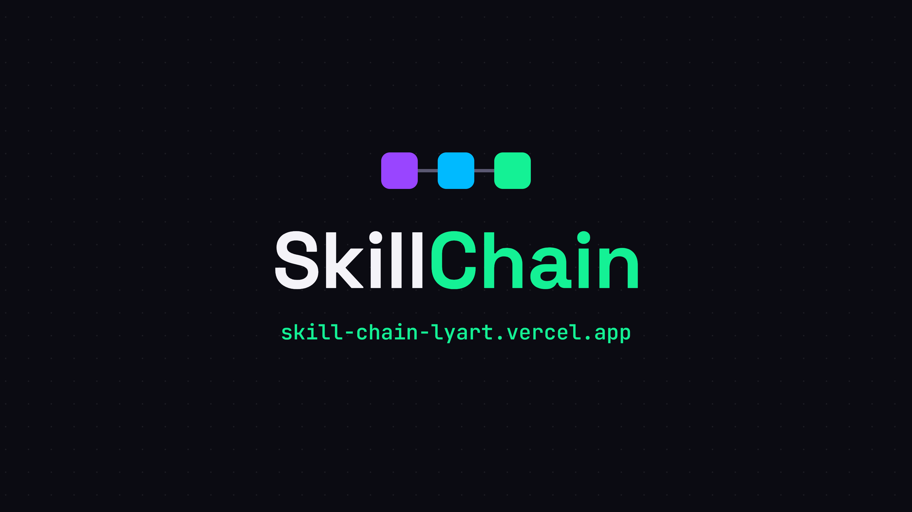

# SkillChain

**SkillChain teaches Solana by playing: three short levels, each one ending with a real transaction on Devnet that proves you did it.**

**Learn Solana by doing.** Every level is a real on-chain transaction, explained by an AI tutor.

MLH Solana Hackathon · 2026 · Network: **Solana Devnet only** (no real money is ever involved)

- **Live app:** https://skill-chain-lyart.vercel.app
- **Pitch deck:** [`docs/SkillChain-Pitch-Deck.pdf`](docs/SkillChain-Pitch-Deck.pdf)
- **Demo video:** _add YouTube link_



## The problem

Blockchain is learned by reading. It should be learned by doing.

- **Jargon first:** wallets, keys, lamports and PDAs arrive as words, not experiences.
- **No real practice:** tutorials explain transactions. Beginners rarely send one.
- **Nothing to show:** course progress lives on someone else's server.

SkillChain turns each concept into a short lesson, a quiz and a real transaction, with a proof anyone can check on Solana Explorer.

## Program ID (Devnet)

[`AqdB1HaXB8wnvwGFTNsxTRrpSNMMVs2x5t4bz6UxU2X7`](https://explorer.solana.com/address/AqdB1HaXB8wnvwGFTNsxTRrpSNMMVs2x5t4bz6UxU2X7?cluster=devnet)

## Features

**The game**

- **Three levels**, each with a short lesson, a quiz and an on-chain task:
  1. **Wallet** – wallets, keys, SOL and Devnet. The task creates your on-chain profile.
  2. **Transactions** – signatures, fees, lamports and the Explorer. The task sends 0.01 SOL to another wallet.
  3. **Accounts** – accounts, rent, programs and PDAs. The task saves a note (up to 100 bytes) in a PDA.
- **Points:** 100, 150 and 200 points for levels 1, 2 and 3 (450 in total).
- **Shop and avatar:** spend points on four items (Devnet Frame, Validator Frame, Turbo Goggles, PDA Master title). Items are equipped on a layered SVG avatar and the choice is stored on-chain.
- **Leaderboard:** read straight from the on-chain profiles (level first, then total points earned), with a rival card that tells you how many points you need to pass the next player.
- **Completed levels** show the proof (links to your accounts on Solana Explorer) and can be replayed in review mode without repeating the transaction.

**Built on top of the game**

- **AI tutor** – after a level, "Explain my transaction" reads your real transaction from Devnet, reduces it to verified facts (fee, accounts and their roles, balance changes, the program instruction, the `LevelCompleted` event) and asks Google Gemini for a short, beginner-friendly explanation tied to the level's concept. If the AI fails, takes more than 10 seconds or runs out of quota, a template explanation built from the same facts is shown and labelled as such. It also works for levels you completed earlier.
- **Tutor chat** – follow-up questions about Solana and your transaction: 3 questions per transaction, 300 characters each, off-topic questions are politely declined, and suggested questions have pre-written answers if the AI is unavailable.
- **Public profile** – `/u/<address>` shows any player's avatar, level, points, items, note and rank, read from the blockchain with no wallet needed, plus "Verified on Solana" links to the profile, note and program accounts.
- **Speedrun and duels** – "Challenge a friend" shares `/challenge/<address>`. A run is timed only from on-chain data: from the first `InitProfile` transaction on the profile account to the `created_at` of the level 3 note. `/challenge/<a>/<b>` compares two players side by side, with Explorer links to their start and end transactions so anyone can check the times. The leaderboard has a **Speedrun** tab with the 10 fastest runs.
- **Blink** – the challenge is also a Solana Action ("Blink"): a card that lets a friend create their profile (level 1) from any Blink-aware client, without opening the site. It uses the same text as the challenge page and, after accepting, links to it.
- **Demo mode** – "Try without a wallet" lets anyone try the whole app with a simulated player and leaderboard. A banner makes clear that nothing is on-chain, and connecting a real wallet leaves demo mode.
- **English and Portuguese** – English by default, with an EN/PT switch in the header. Numbers follow the language (0.5 SOL / 0,5 SOL).

## Why Solana

The chain is the referee. There is no backend database and no admin key.

- **Proof:** every level is a transaction anyone can check.
- **Ownership:** progress, points and items live in the player's own PDAs, not on our server. Points are earned, never bought or transferred.
- **Speed and cost:** fast confirmations and tiny fees make learning by doing practical.

## Architecture

```
Browser (Next.js)  ──────────────►  Solana Devnet RPC  ◄──────────────  Anchor program
  wallet adapter, UI, hand-written          reads accounts, sends          Profile and Note
  Borsh codec from the IDL                  signed transactions            PDA accounts
        │
        └──►  Next.js route handlers  ──►  Devnet RPC (read-only)  and  Google Gemini
              /api/tutor*   AI tutor       /api/actions/*   Blink
```

### On-chain program (Anchor)

Source reference: [`anchor/programs/skillchain/src/lib.rs`](anchor/programs/skillchain/src/lib.rs). IDL: [`src/idl/skillchain.json`](src/idl/skillchain.json). The program was published to Devnet with Solana Playground and is **not modified by this repository's front-end**.

| Account | PDA seeds | Holds |
| --- | --- | --- |
| `Profile` (62 bytes) | `["profile", wallet]` | owner, level (1 to 3), spendable points, total earned, items bitmask, equipped frame, accessory and title |
| `Note` (153 bytes) | `["note", wallet]` | owner, message (up to 100 bytes), `created_at` |

| Instruction | What it does |
| --- | --- |
| `init_profile` | Level 1. Creates the `Profile` PDA (the wallet pays the rent) |
| `complete_level_2` | Level 2. Transfers 0.01 SOL to a recipient other than yourself |
| `complete_level_3(message)` | Level 3. Creates the `Note` PDA with your message |
| `buy_item`, `equip_item`, `unequip_item` | Shop and avatar |

The program emits `LevelCompleted` and `ItemBought` events and defines 11 custom errors (codes 6000 to 6010), which the front-end maps to clear messages.

### Front-end

- **Stack:** Next.js 16 (App Router), React 19, Tailwind 4, TypeScript, `@solana/web3.js` v3, Wallet Adapter v3, Vitest.
- **Data layer** (`src/lib/skillchain`): one `SkillChainBackend` interface with a real implementation and an in-memory mock. The real one uses a hand-written Borsh codec built from the IDL (no Anchor client in the browser). Demo mode switches to the mock per call, with no reload.
- **Transactions:** every one shows signing, confirming, confirmed (with an Explorer link) or a clear error.
- **i18n:** typed English and Portuguese dictionaries (`src/i18n`) and lessons in `src/content/lessons.en.json` and `lessons.pt.json`.

### AI tutor routes (server only)

| Route | Purpose |
| --- | --- |
| `POST /api/tutor` | Fetches the transaction from Devnet, checks it calls the SkillChain program, extracts facts and returns the explanation (`source`: `ai` or `template`) |
| `POST /api/tutor/ask` | Follow-up question with the facts, the level's lesson and at most 2 earlier exchanges |
| `POST /api/tutor/find` | Finds the transaction that completed a level you finished earlier, so it can be explained |

Protections: the Gemini key lives only on the server, in-memory cache by signature and language, 10 requests per IP per 5 minutes, request size caps, and the player's note is always treated as data, never as instructions. Code in `src/lib/tutor`.

### Blink (Solana Action)

| Route | Purpose |
| --- | --- |
| `GET /api/actions/challenge[/<address>]` | The action card, with the challenger's time when known |
| `POST /api/actions/challenge[/<address>]` | Returns an **unsigned** `init_profile` transaction (fee payer is the player), or a friendly error if the wallet already has a profile |
| `POST /api/actions/challenge/open` | Chained step that returns the challenge page link |
| `GET /actions.json` | Maps `/challenge/*` to the action |

Responses carry the Solana Actions CORS headers plus `X-Action-Version` and `X-Blockchain-Ids: solana:EtWTRABZaYq6iMfeYKouRu166VU2xqa1` (Devnet). Code in `src/lib/blink`.

## How to test

### With Phantom on Devnet

1. Install the [Phantom](https://phantom.com) wallet.
2. Switch Phantom to Devnet: **Settings → Developer Settings → Testnet Mode**, then choose **Solana Devnet**.
3. Get free test SOL from the [Solana faucet](https://faucet.solana.com) (choose Devnet). About 0.05 SOL is more than enough for the three levels (the shop uses points, not SOL).
4. Open https://skill-chain-lyart.vercel.app, click **Connect wallet** and play:
   - Level 1 creates your profile, level 2 sends 0.01 SOL to another address (paste any other wallet), level 3 saves a note.
   - After each level, try **Explain my transaction** and ask the tutor a question.
5. Open `/leaderboard` (Ranks and Speedrun tabs) and your public profile at `/u/<your address>`.
6. Click **Challenge a friend** and open the link from another wallet to see the duel.

### Without a wallet

Click **Try without a wallet** on the landing page. You get a simulated player and leaderboard, a banner reminds you that nothing is on-chain, and links to Solana Explorer are replaced by a note. **Use a real wallet** leaves demo mode.

### Testing the Blink on Devnet

On your profile or after level 3, **Challenge a friend** has a "Test as a Blink (Devnet)" link that opens the action in the Dialect inspector (`https://dial.to/devnet?action=solana-action:<action URL>`). Accept with a wallet that has no profile and a few Devnet SOL to create it in one step.

## Run locally

Requirements: Node.js 24 or newer and [pnpm](https://pnpm.io).

```bash
pnpm install
cp .env.example .env        # then fill in the values (see below)
pnpm dev                    # http://localhost:3000
```

| Command | What it does |
| --- | --- |
| `pnpm dev` | Development server |
| `pnpm lint` | ESLint |
| `pnpm typecheck` | TypeScript check (`tsc --noEmit`) |
| `pnpm test` | Unit tests (Vitest) |
| `pnpm build` | Production build |

While `NEXT_PUBLIC_SKILLCHAIN_PROGRAM_ID` is empty (or `NEXT_PUBLIC_USE_MOCK=true`), the app runs on in-memory mock data and shows a "Mock" badge in the header. Always use Devnet and never put private keys in the environment.

## Environment variables

Names only; see [`.env.example`](.env.example). Set them in `.env` locally and in the Environment Variables of your hosting (Vercel).

| Variable | Used by | Purpose |
| --- | --- | --- |
| `NEXT_PUBLIC_SOLANA_RPC` | Browser and server | Devnet RPC endpoint |
| `NEXT_PUBLIC_SKILLCHAIN_PROGRAM_ID` | Browser and server | Program ID of the deployed program |
| `NEXT_PUBLIC_USE_MOCK` | Browser | Set to `true` to force the in-memory mock (development) |
| `GEMINI_API_KEY` | **Server only** | Google Gemini key for the AI tutor. Never prefix it with `NEXT_PUBLIC_`. Without it the tutor answers with templates |
| `GEMINI_MODEL` | Server only | Optional Gemini model name (defaults to `gemini-3.5-flash-lite`) |
| `NEXT_PUBLIC_SITE_URL` | Server | Optional production URL used for Open Graph metadata |

## Known limitations

- **Devnet only.** The program and all data live on Solana Devnet, which can be reset or be slow.
- **The quiz is checked in the front-end.** The on-chain task is the real proof that a level was completed.
- **Tutor limits are per server instance.** The cache, the per-IP rate limit and the 3-questions-per-transaction counter live in memory, so on serverless hosting they are not global.
- **The AI can be wrong or unavailable.** Explanations are built only from the verified transaction facts, but a model can still phrase things badly; the template fallback covers outages and quota limits.
- **Speedrun board:** it times at most 30 finished players and reads several accounts from Devnet, so its first load can take a few seconds.
- **Challenge names are not verified.** The optional name in a challenge link lives only in the link, is sanitized, and is always shown next to the wallet address.
- **Blinks** depend on the client: the Dialect inspector works with Devnet; other clients may require the action to be registered or may only support mainnet.
- **Wallet buttons and modals** come from the Wallet Adapter library and stay in English.
- **Only the Phantom wallet was tested** for the full flow.

## What's next

- More paths: tokens, NFTs, DeFi basics
- Non-transferable on-chain certificates
- Seasons and tournaments
- Classroom mode for universities and bootcamps

## Documentation

- [`SDD.md`](SDD.md): full specification, the source of truth (Portuguese).
- [`FUNCIONALIDADES.md`](FUNCIONALIDADES.md): detailed description of every added feature (Portuguese).
- [`PROGRESSO.md`](PROGRESSO.md): record of the first phases and decisions (Portuguese).
- [`docs/SkillChain-Pitch-Deck.pdf`](docs/SkillChain-Pitch-Deck.pdf): the pitch deck.
- [`design/`](design/): visual prototype and screenshots.

## License

[MIT](LICENSE)
